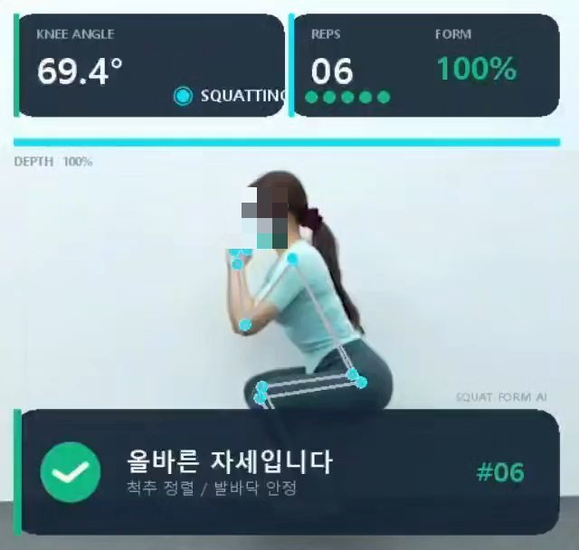
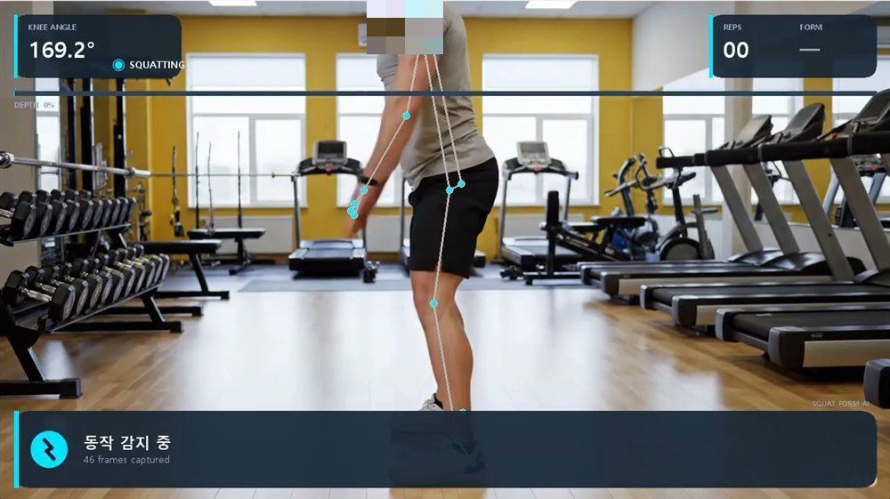
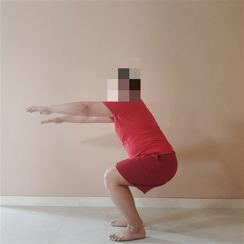
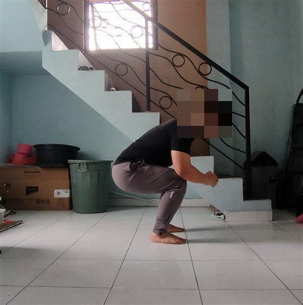
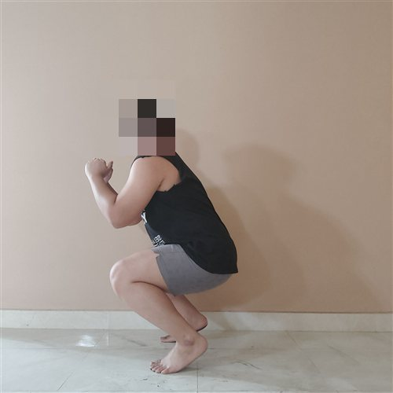
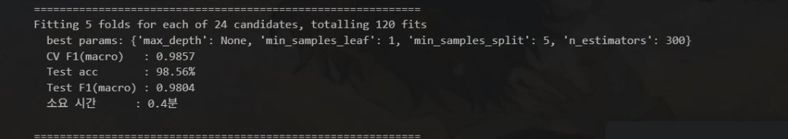
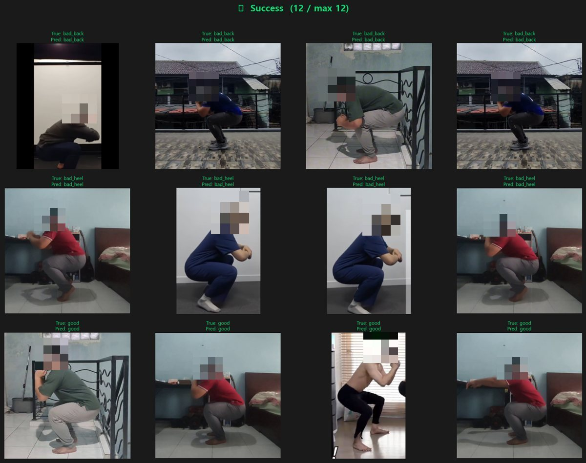
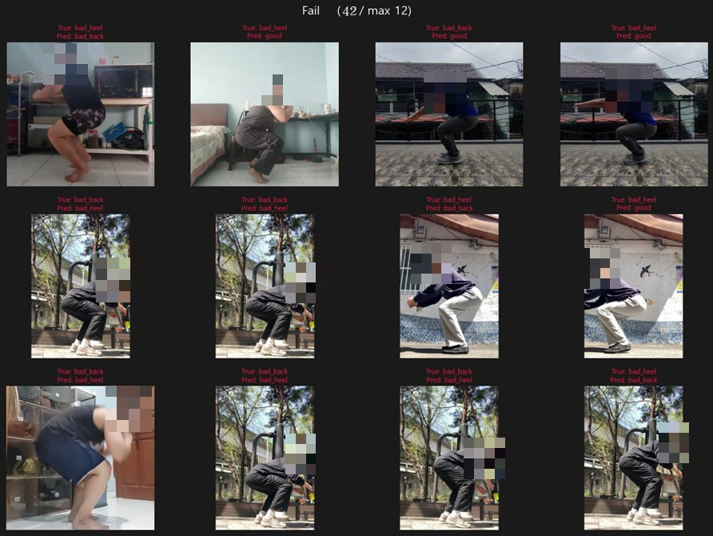

# 스쿼트 자세 교정 AI 시스템

MediaPipe Pose로 관절 좌표를 추출하고, 머신러닝 분류기와 규칙 기반 보정을 결합해 **스쿼트 자세를 실시간으로 판정하고 피드백**하는 시스템입니다.

> 종합설계 프로젝트 · 2026 · 팀원: 이혜진, 임지연

<p align="center">
  
  
</p>

## 주요 결과

| 항목 | 값 |
|------|-----|
| 테스트 정확도 | **98.56%** (2,914장 중 42장 오분류) |
| Test F1 (macro) | 0.9804 |
| CV F1 (macro, 5-fold) | 0.9857 |
| 학습 데이터 | 14,566장 (good 4,923 / bad_back 4,822 / bad_heel 4,821) |
| 판정 클래스 | `good` · `bad_back` (허리 굽음) · `bad_heel` (뒤꿈치 들림) · `shallow` (깊이 부족) |

## 데이터셋

[Zenodo Squat Dataset](https://zenodo.org/records/17558630)을 사용했습니다. 모두 측면에서 촬영한 스쿼트 이미지이고, 3개 클래스로 나뉩니다.

| good | bad_back | bad_heel |
|:---:|:---:|:---:|
|  |  |  |
| 무릎·골반·발목 정렬 양호, 허리 중립 | 상체가 과도하게 앞으로 숙여짐 | 뒤꿈치가 들려 발바닥이 다 닿지 않음 |

## 동작 방식

```
영상 프레임 ──▶ MediaPipe Pose ──▶ 14개 피처 추출 ──▶ 페이즈 감지 (IDLE ↔ SQUATTING)
                                                            │
                                         한 번의 스쿼트 동작(rep)이 끝나면
                                                            ▼
                          descent / bottom 구간 분리 ──▶ 분류 모델 예측 ──▶ 규칙 기반 보정 ──▶ 화면 피드백
```

### 피처 설계 (14개)
- **관절 각도**: 무릎 · 골반 · 발목 (좌/우)
- **몸통 기울기** (`torso_L/R`): 어깨–골반 벡터와 수직선이 이루는 각도. `bad_back`과 `bad_heel`이 서로 헷갈리던 문제를 해결한 핵심 피처
- **뒤꿈치 들림** (`heel_lift_L/R`), **무릎 전방 이동** (`cave_L/R`)
- **좌우 대칭성** (`sym_knee`), **무릎 깊이** (`knee_depth`)
- 거리값은 모두 **대퇴골 길이로 정규화**해 카메라 거리나 체형이 달라도 결과가 흔들리지 않도록 했습니다.

### 영상 추론 안정화
- **N프레임 연속 조건**: 무릎 각도가 155° 미만인 프레임이 3번 연속 나와야 SQUATTING으로 들어가고, 165° 이상이 3번 연속 나와야 끝난 것으로 봅니다. 키포인트가 한 프레임 튀어서 생기는 오감지를 막습니다.
- **Visibility 가중 평균**: 측면 촬영에서 가려진 쪽 다리의 영향을 줄입니다.
- **시계열 구간 분리**: 허리 굽음은 내려가는 구간(descent)에서, 뒤꿈치 들림은 최저점(bottom)에서 잘 드러납니다. 그래서 두 구간을 따로 예측한 뒤 `bottom × 0.6 + descent × 0.4`로 합칩니다.
- **모델 + 규칙 결합**: 모델 확률이 높으면 모델 판정을 따르고, 각도 규칙으로 false positive / false negative를 한 번 더 보정합니다. 결함 두 개를 동시에 검출할 수도 있습니다.

### 모델
`02_train.py`가 RandomForest, ExtraTrees, XGBoost, LightGBM, Stacking을 GridSearch(5-fold, macro-F1)로 비교하고, 가장 좋은 모델을 저장합니다.



## 테스트 결과

**성공 사례**: 테스트셋 2,914장 중 2,872장을 맞혔습니다. 체형이나 옷차림, 촬영 거리가 달라도 안정적으로 분류합니다.



**실패 사례**: 42장을 틀렸습니다. 주로 `bad_back`과 `bad_heel`을 서로 헷갈리거나 결함이 있는 자세를 `good`으로 놓쳤고, 원인은 복잡한 야외 배경, 조명 변화, 기구나 자기 몸에 신체 일부가 가려진 경우였습니다.



## 프로젝트 구조

```
.
├── src/
│   ├── 01_preprocess.py          # 이미지 → 피처 CSV (좌우 반전 증강 포함)
│   └── 02_train.py               # 모델 비교 · 학습 · 시각화
├── notebooks/
│   └── 03_realtime_feedback.ipynb  # 영상/웹캠 실시간 자세 판정 + UI
├── assets/images/                # README 이미지 (인물 얼굴 모자이크 처리)
├── requirements.txt
└── README.md
```

## 실행 방법

### 1. 환경 설정
Python 3.10 기준으로 작성했습니다.

```bash
pip install -r requirements.txt
```

> MediaPipe는 `mp.solutions` API를 쓰기 때문에 `0.10.x` 버전이 필요합니다 (개발 환경: 0.10.9).

### 2. 데이터셋 준비
[Zenodo Squat Dataset](https://zenodo.org/records/17558630)을 내려받아 아래처럼 클래스별 폴더로 넣어 주세요. 데이터셋은 용량 문제로 저장소에 포함하지 않았습니다.

```
data/images/
├── bad_back/
├── bad_heel/
└── good/
```

### 3. 전처리 → 학습

```bash
python src/01_preprocess.py          # data/features_orig.csv, data/features_aug.csv 생성
python src/02_train.py --mode full   # models/rf_model.pkl 생성 (빠르게 돌리려면 --mode quick)
```

### 4. 실시간 판정
`notebooks/` 폴더에서 `03_realtime_feedback.ipynb`를 열고, 마지막 셀의 `VIDEO_SOURCE`에 영상 경로를 넣으세요. 웹캠을 쓰려면 `0`을 넣으면 됩니다. 창에서 `q` 또는 `ESC`를 누르면 종료됩니다.

## 한계 및 개선 방향
- 학습 데이터는 정지 이미지인데 추론은 영상에서 합니다. 그래서 프레임마다 키포인트가 흔들리는 것이 피처에 노이즈로 들어갑니다.
- 카메라가 정측면이 아니라 사선에 있으면 2D 평면에서 어깨–골반 벡터가 왜곡되어, 몸통 기울기가 실제보다 작게 측정됩니다.
- 한 자세에 결함이 두 개 있으면 한쪽만 감지되는 경우가 있습니다.

## 기술 스택
Python · MediaPipe · OpenCV · scikit-learn · XGBoost · LightGBM · pandas · matplotlib · Pillow
